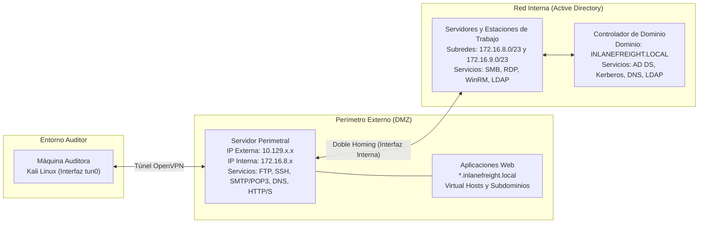

# Informe Técnico de Prueba de Penetración: Attacking Enterprise Networks (Inlanefreight)

Este repositorio almacena el informe técnico y la documentación asociada a la auditoría de seguridad ofensiva (prueba de penetración de alcance completo en modalidad de **caja negra**) realizada sobre la infraestructura corporativa ficticia **Inlanefreight** (`INLANEFREIGHT.LOCAL`), correspondiente al módulo final *Attacking Enterprise Networks* de **Hack The Box Academy**.

## Información Académica

* **Autor:** Daniel Damota Maldonado
* **Profesor:** Carlos Basulto Pardo
* **Módulo:** Hacking Ético
* **Titulación:** Curso de Especialización en Ciberseguridad en Entornos de las Tecnologías de la Información (CETI) — Curso 2026-2027
* **Fecha de entrega:** Noviembre de 2026

## Topología Lógica del Laboratorio

El siguiente diagrama muestra la arquitectura de red, el direccionamiento y los servicios desplegados en el entorno del laboratorio:



## Resumen del Encargo y Fases Ejecutadas

El objetivo de la evaluación fue simular la perspectiva de un atacante externo anónimo desde Internet —sin credenciales ni información previa— con el fin de identificar debilidades en el perímetro expuesto y evaluar hasta qué punto podían encadenarse para comprometer la red interna y el dominio de Active Directory.

1. **Reconocimiento Externo y Enumeración:** Identificación de puertos abiertos, transferencia de zona DNS (`AXFR`), descubrimiento de subdominios (`*.inlanefreight.local`) y caracterización de servicios expuestos en la DMZ (`10.129.x.x`).
2. **Explotación Web y Acceso Inicial:** Auditoría de aplicaciones web según **OWASP WSTG**, explotación de vulnerabilidades críticas para obtención de ejecución remota de código (RCE) y estabilización de sesión interactiva.
3. **Escalada de Privilegios Local y Persistencia:** Elevación de privilegios a `root` en el servidor perimetral e implementación de mecanismos de persistencia controlados y reversibles.
4. **Pivoting y Reconocimiento Interno:** Establecimiento de túneles de red mediante **Ligolo-ng / Chisel** hacia las subredes internas (`172.16.8.0/23` y `172.16.9.0/23`).
5. **Enumeración y Ataques a Active Directory:** Cartografía del dominio mediante **BloodHound CE**, extracción de tickets mediante *Kerberoasting* / *AS-REP Roasting* y auditoría offline de contraseñas.
6. **Movimiento Lateral y Compromiso Total:** Desplazamiento entre equipos mediante WinRM/SMB/RDP y ejecución de ataque **DCSync** para demostrar el control total sobre `INLANEFREIGHT.LOCAL` (`Domain Admin`).
7. **Post-explotación, Impacto y Cierre:** Evaluación del impacto empresarial y reversión íntegra de todos los artefactos generados durante la prueba (*engagement closeout*).

## Metodología y Stack Tecnológico

La auditoría se ha ejecutado bajo los estándares **PTES** (*Penetration Testing Execution Standard*) y **NIST SP 800-115**, mapeando cada técnica al marco **MITRE ATT&CK** y evaluando el riesgo mediante **CVSS v4.0** y **CWE**.

* **Reconocimiento y Fuzzing:** `Nmap`, `dig`, `ffuf`, `feroxbuster`, `EyeWitness`
* **Auditoría Web:** `Burp Suite Community`, `WPScan`, `sqlmap`
* **Pivoting y Túneles:** `Ligolo-ng`, `Chisel`, `SSH`, `proxychains`
* **Active Directory y Post-Explotación:** `BloodHound CE`, `Impacket`, `NetExec`, `evil-winrm`, `Mimikatz`, `Rubeus`, `Responder`
* **Auditoría de Credenciales:** `hashcat`, `John the Ripper`
* **Documentación y Trazabilidad:** `Obsidian`, `tmux-logging`, `SysReptor` (exportación a PDF vía LaTeX)

## Estructura del Repositorio

```text
├── docs/
│   └── Informe_Tecnico_Pentest_Inlanefreight.pdf   # Documento final entregable
├── capturas/                                       # Evidencias gráficas (enmascaradas)
├── anexos/                                         # Tablas de inventario y registro de cierre
└── README.md                                       # Documentación principal del repositorio
```

## Aviso Ético y Legal

> **IMPORTANTE:** Todas las pruebas documentadas en este proyecto se han realizado exclusivamente dentro del entorno controlado y autorizado del laboratorio *Attacking Enterprise Networks* de **Hack The Box Academy**.
> 
> * La empresa objetivo (**Inlanefreight**), sus sistemas, usuarios y datos son completamente ficticios.
> * En cumplimiento de la normativa académica y de las políticas de uso de Hack The Box, **no se publican flags, soluciones directas del laboratorio ni credenciales en claro** (todos los datos sensibles aparecen debidamente enmascarados).
> * El acceso no autorizado a sistemas informáticos reales constituye un delito tipificado en el **artículo 197 bis del Código Penal español**. Este material tiene fines estrictamente educativos y defensivos.
